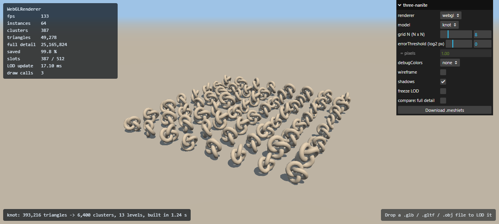
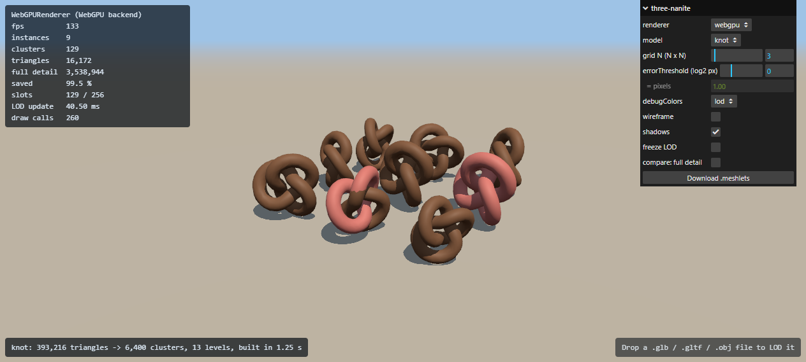

# three-nanite

Nanite-style cluster LOD for three.js: a mesh is split into small clusters ("meshlets"), the clusters are organised into a DAG of progressively simplified versions, and at render time each instance draws a crack-free mix of detail levels chosen by its projected error on screen.

- Works with **`WebGLRenderer` and `WebGPURenderer`** (WebGPU back-end and its WebGL 2 fallback), same code path for both.
- Works with **any standard material** (`MeshStandardMaterial`, node materials, `onBeforeCompile` hooks), including shadows, fog and vertex attributes such as `uv1` or `color`.
- **Instancing built in**: one `MeshletMesh` draws many copies, each with its own level of detail. Copies that need one detail level throughout, which is every copy more than a few radii away and every copy of a small model, are drawn with real instancing: one draw per level in use, however many copies there are. Only the copies the camera is close to get a cut of their own.
- **Many different models, one draw call**: `MeshletBatch` draws every model that shares a material, each with its levels and any number of copies, as a single draw. A city of 700 different models in 59 materials is 60 draw calls, at a third to a quarter of the frame time of one `InstancedMesh` per model.
- **Small models are not penalised**: thousands of copies of a 300 triangle fern are a handful of instanced draws, in effect an `InstancedMesh` with levels of detail and per-instance frustum culling.
- **Bake offline, load at runtime**: the hierarchy is plain typed arrays with a zero-copy binary format. The runtime entry point has no WebAssembly and no dependency besides three.
- Vertex data is **shared by all detail levels** (simplification does not create vertices), so the cost over the original mesh is roughly a second index buffer.

<p align="center">

</p>

64 copies of a 393,216 triangle mesh (25 million triangles at full detail) drawn with 49 thousand, at an error budget of one pixel. Below, the same scene coloured by detail level: parts of one object nearer the camera use finer clusters, with no seams between levels.

<p align="center">

</p>

## Install

```sh
npm install three-nanite three
```

`three` is a peer dependency (r170 or newer; tested on 0.170, 0.180 and 0.187 with both renderers). Node 20+ for the build tools. On `WebGPURenderer` the instanced levels need r187: with older versions every instance is drawn by cluster on that renderer (see "Things worth knowing").

## Quick start

### 1. Build the hierarchy (once, ideally offline)

```ts
import { buildMeshletsFromGeometry } from "three-nanite/build";
import { serializeMeshlets } from "three-nanite";

const data = await buildMeshletsFromGeometry(geometry); // indexed, welded BufferGeometry
await writeFile("rock.meshlets", new Uint8Array(serializeMeshlets(data)));
```

`three-nanite/build` runs in browsers, workers and Node (it uses [meshoptimizer](https://github.com/zeux/meshoptimizer)'s WebAssembly build). A 400k triangle mesh takes a bit over a second. The geometry should be indexed and welded; run `BufferGeometryUtils.mergeVertices` first if it is not.

### 2. Draw it

```ts
import { deserializeMeshlets, MeshletMesh } from "three-nanite";

const data = deserializeMeshlets(await (await fetch("rock.meshlets")).arrayBuffer());

const rocks = new MeshletMesh(data, new THREE.MeshStandardMaterial());
rocks.castShadow = rocks.receiveShadow = true;
rocks.count = 500;
for (let i = 0; i < 500; i++) rocks.setMatrixAt(i, matrixOf(i));
scene.add(rocks);
```

That is all: the level of detail is recomputed automatically for the camera being rendered. The same code runs under `WebGPURenderer`.

## API

### `three-nanite` (runtime)

| Export | Purpose |
| --- | --- |
| `MeshletMesh` | The object you add to the scene. |
| `deserializeMeshlets(buffer)` / `serializeMeshlets(data)` | `.meshlets` files. Deserializing creates views on the buffer, without copying. |
| `createLodGeometry(data, maxError)` | A plain, static `BufferGeometry` for one fixed detail level. |
| `createLodChain(data, { maxLevels })` / `getLodErrors(data)` | A conventional discrete LOD chain out of the same hierarchy. |
| `geometryToMeshletInput(geometry)` | `BufferGeometry` to builder input. |
| `ClusterSelector`, `lodScale`, `countTriangles` | The LOD selection itself, free of three.js objects, for custom renderers. |
| `computeLodLevels(data)`, `levelForError`, `levelOfCut`, `copyLevelIndices` | The whole-mesh levels of a hierarchy: the small family of cuts that are one detail level throughout, each as index runs. What `MeshletMesh` instances by. |
| `computeDrawRanges(data)`, `rangesOfCut(ranges, cut, n)` | The index ranges a cut is drawn in: clusters that are always drawn together, fused. |
| `validateMeshletData(data)` | Consistency check; returns a list of problems. |
| `prepareCutoutTexture(texture, alphaTest)`, `cutoutMipmaps(image, alphaTest)` | For alpha cut-outs (leaves, grass cards): fills the transparent texels with the colour around them, so filtering no longer darkens the edges, and makes mipmaps that keep the share of texels that pass `alphaTest`, so a canopy does not go bare with distance. Both renderers. See "Foliage". |

#### `MeshletMesh`

```ts
new MeshletMesh(data, material?, {
  errorThreshold?, maxInstances?, instancedLevels?, levelDistance?, cullInstances?, drawCost?, initialDrawCapacity?, mergeClusters?,
})
```

It behaves like an `InstancedMesh`:

| Member | |
| --- | --- |
| `count` | Number of instances. Starts at 1 with an identity matrix. |
| `setMatrixAt(i, matrix)` / `getMatrixAt(i, target)` | Instance transform, relative to the `MeshletMesh`. |
| `setColorAt(i, color)` / `getColorAt(i, target)` | Instance tint. |
| `errorThreshold` | Allowed geometric error in **pixels** (default 1). The quality/performance dial. |
| `autoUpdate` | Default `true`: the renderer updates the LOD for the camera it renders with, the way it updates a `THREE.LOD`. Set `false` and call `update(camera, viewportHeight)` yourself for full control. |
| `lodCamera` | Pin LOD to one camera regardless of which camera renders (debugging, or keeping reflections in step with the main view). |
| `viewportHeight` | Height in pixels for the automatic update. `null` (default) takes it from the renderer. |
| `levelDistance` | How many radii away an instance takes a whole-mesh level without its hierarchy being walked (default 3). Larger: fewer triangles on mid-range instances of large meshes, more per-cluster draws. |
| `cullInstances` | Default `true`: instances outside the view are left out of the instanced draws of the main pass, and a level with no instance in view is not drawn in it at all. |
| `drawCost` | What one more draw call is worth, in triangles (default 4096). Every level in use is a draw, so instances are drawn finer than they need when that saves a draw for fewer triangles than this. `0`: every instance at exactly its own level. |
| `debugColors` | `"none"`, `"cluster"` or `"lod"`: tints what is drawn, on any material and renderer. `"cluster"` draws every instance by cluster; construct with `mergeClusters: false` to tint (and draw) every cluster by itself. |
| `getLevelAt(i)`, `getTriangleCountAt(i)` | The whole-mesh level instance `i` is drawn at (-1 when it is drawn by cluster), and its triangles. |
| `stats` | `{ instances, clusters, draws, triangles, slots, levelInstances, levelVisible, levelDraws, lastUpdateMs, lastSelected }`. `draws` is what a pass pays for. |
| `levels` | The whole-mesh levels of the hierarchy (`LodLevels`). |
| `boundingSphere` | Sphere around all instances, in the object's own space. |
| `material`, `castShadow`, `receiveShadow`, `renderOrder`, `layers`, `customDepthMaterial`, `customDistanceMaterial` | Forwarded to every internal draw mesh. |
| `batched`, `drawCapacity`, `onRebuild`, `levelMeshes` | The internal `THREE.BatchedMesh` and `THREE.InstancedMesh`es; see "Draw capacity" below. Each is a child of the `MeshletMesh` only while it has something to draw, and uses its world matrix. |
| `dispose()` | Frees GPU buffers and textures (not the material). |

Raycasting works through `raycaster.intersectObject(mesh, true)`: hits report `object === mesh` and `instanceId`, and test the detail level currently drawn.

*Use it for a model the camera gets close to that is large enough to need different detail in different places, and for a scene of few kinds of model. For many kinds, see `MeshletBatch` below.*

Things worth knowing:

- **Two ways of drawing an instance**, chosen per instance on every update. *By level*: an instance that needs one detail level throughout is drawn at one of the mesh's whole-mesh levels, and all instances on a level are one `InstancedMesh`: one draw. An instance at least `levelDistance` radii away takes its level from its distance alone, without its hierarchy being walked; a nearer one takes a level when its cut turns out to be one, which for small models is always. *By cluster*: an instance close enough to need different detail in different places gets its own cut of the DAG, drawn through a `BatchedMesh`, a draw per run of clusters. `instancedLevels: false` draws everything by cluster.
- **LOD follows the viewer, in every pass.** Shadow passes reuse what was chosen for the main camera, so a shadow always matches the mesh that casts it. Instances drawn by cluster are frustum culled per cluster for each pass's own camera; instances drawn by level are culled per instance for the main view, and all of them are drawn in shadow passes.
- **Turning the camera is nearly free, and moving it costs what changes.** The level of detail depends only on the camera position, projection, viewport height and threshold. If none of those changed and no instance moved, `update` only re-tests which instanced instances are in view (a sphere test each, or one test for all of them when the sphere around them is wholly in view or out of it). When the camera moves, an instance on a whole-mesh level is not looked at again until the camera has travelled as far as it takes to bring it to the next level, so far instances are left alone for a long time. If only some instances moved, only those are re-evaluated.
- **Draws.** A pass costs one draw per level in use plus, for the instances drawn by cluster, one per run of clusters that are always drawn together (3 to 16 times fewer than clusters). 2,304 copies of a 20,000 triangle tree in three materials take about 380 draws, where a draw per cluster run of every instance took 10,900. A draw is not free, so a level is only used where it pays (`drawCost`): a small mesh with a handful of copies stays at one draw, at the detail of its nearest copy, instead of one draw per level.
- **Cost of an update.** Flying a camera through those 2,304 trees (6,912 instances over the three materials) costs about 0.4 ms per frame on a desktop CPU, turning it 0.15 ms. 4,096 ferns: 0.06 ms. 1,024 copies of a 393k triangle mesh: 0.03 ms.
- **Many different models.** A scene of hundreds of `MeshletMesh`es is fine: one that has nothing in view costs a fraction of a microsecond per frame and no draw, and its draw meshes are in the scene only while they draw something. The guidance at the end of "Using it in a game" says what such a scene gains.
- **Draw capacity.** Every (instance, cluster run) pair drawn by cluster occupies a slot of the internal `BatchedMesh`. When slots run out that mesh is rebuilt with more capacity and `batched` becomes a new object. The vertex and index buffers are shared, so nothing is re-uploaded, but re-registering the clusters takes a few milliseconds per thousand clusters, a visible hitch if it happens mid-game. Pass `initialDrawCapacity` (watch `stats.slots` for a realistic number) to avoid it, and use `onRebuild` if you customise `batched` directly. The instanced meshes of the levels are replaced by larger ones in the same way, which is cheap.
- **Materials** are drawn through both `BatchedMesh` and `InstancedMesh`. Standard and node materials handle both by themselves; a material that patches shaders with `onBeforeCompile` must work with three's batching chunks and with `instanceMatrix`.
- **Per-instance data** beyond matrix and color has no slot of its own.
- **`WebGPURenderer` before r187** binds the buffers of an `InstancedMesh` in ways that do not survive the instance count changing between passes. `MeshletMesh` notices and draws every instance by cluster on that renderer with those versions, as it did before there were levels. `WebGLRenderer` has no such limit.

#### `MeshletBatch`

```ts
const batch = new MeshletBatch([dataA, dataB, ...], material, {
  maxInstances?, errorThreshold?, drawCost?, cullInstances?, maxLevels?,
});
const id = batch.addInstance(meshIndex, matrix);   // any number, of any of the meshes
scene.add(batch);
```

A `MeshletMesh` is one model, and every level of it in use is a draw call. That is right for a few kinds of model with many copies; a scene of hundreds of kinds is then hundreds of draw calls whatever the models cost, and on the web a draw call costs microseconds of script: such a scene is bound by its draw calls long before its triangles. A `MeshletBatch` holds every model that shares a material. Each frame it chooses a level for every instance, sorts the instances by model and level, and draws all of them at once: one draw call a material.

| Member | |
| --- | --- |
| `addInstance(mesh, matrix?)` | Adds an instance of `meshes[mesh]`; returns its id. Capacity grows by itself (`maxInstances` avoids the rebuilds). |
| `setMatrixAt(i, matrix)` / `getMatrixAt`, `getMeshAt(i)`, `setVisibleAt(i, visible)` / `getVisibleAt` | Per instance. |
| `errorThreshold`, `autoUpdate`, `lodCamera`, `viewportHeight`, `cullInstances`, `update(camera, viewportHeight?)` | As on `MeshletMesh`. |
| `drawCost` | As on `MeshletMesh`, for a sub-draw, which costs far less than a draw call: default 512. |
| `getLevelAt(i)`, `getTriangleCountAt(i)`, `levels`, `stats` | `stats`: `{ meshes, instances, visible, draws, triangles, trianglesAll, lastUpdateMs, lastSelected }`; `draws` are sub-draws of the one draw call. The draw lists, and the counts in `stats` with them, are made when a pass is about to draw. |
| `debugColors` | `"none"` (default) or `"lod"`: every instance tinted by the level it is drawn at, coloured by depth in its hierarchy as `MeshletMesh` colours its levels, on both renderers. The tint multiplies the material's colour, so it reads best on a white material. |
| `material`, `castShadow`, `receiveShadow`, `renderOrder`, `layers` | Those of the draw object. |
| `batched`, `dispose()` | The `THREE.BatchedMesh` that is drawn (replaced when capacity grows). |

Things worth knowing:

- **All meshes of a batch need the same vertex attributes.** Build them with the same `attributes` option.
- **An instance is drawn at one level throughout**, the one its nearest part needs. That is what a model small against the scene needs anyway. A model the camera walks up to and that is large enough to want coarse far ends stays finer than necessary here; put that one in a `MeshletMesh`.
- **How it is drawn.** On `WebGLRenderer`: one `multiDrawElementsInstancedWEBGL` call, a sub-draw per model and level in use with its instances (where a browser lacks `WEBGL_multi_draw`, which today is Firefox, an instanced draw per sub-draw, still without three's cost per object). On `WebGPURenderer`: one render object with a `drawIndexed` per model and level, which is how r187 draws a `BatchedMesh`; it needs r187 or newer there. Instance matrices are in a texture and found through a list of instance ids in draw order, so an instance that changes level or leaves the view costs four bytes of upload, and one that does neither costs nothing.
- **This one is not built on public API alone.** The draw object is a stock `BatchedMesh`, so materials, lights and shadows are three's own; but the batch fills in the draw lists and the id texture `BatchedMesh` keeps for itself, and on `WebGLRenderer` it issues the draw call itself right after three has set everything up for one (three has no instanced multi-draw there). It is checked against r170, r180 and r187; a later three may need it adjusted.
- **Your material is not modified.** `WebGLRenderer` gets a material derived from it (it reads everything from yours, live) with the batch's matrix lookup in place of three's, and depth materials to match for shadows.
- **Culling, also for shadows.** The main pass draws the instances in view, and a shadow pass those in view and those inside its shadow camera's frustum (with `cullInstances`, the default). Per model and level the id list holds the instances in view, then those only the shadow camera sees, then the rest, so each kind of pass draws a leading part of it. A sun's shadow camera that follows the player covers a few hundred metres; a shadow pass used to draw every instance of the scene. In a valley of 280,000 placements that took the frame from 18 to 7.8 million triangles.
- **Culling at scale.** Instances are kept in chunks of 64 in Morton order of their position, each with a box, so a chunk wholly inside or outside a frustum is decided by one test. A moved instance widens its chunk's box; after many moves, or when instances are added, the chunks are made again.
- **What a frame costs with very many instances.** Choosing levels only visits instances near a change of level, but making the draw lists visits every instance once per pass whose lists changed: about 4 ms a frame for 280,000 instances on a desktop CPU while the camera moves. Batches of up to some tens of thousands of instances do not notice it.
- **Not supported**: per-instance colours (beyond `debugColors`), wireframe, and transparent double-sided materials drawn in two passes. Instances are not sorted by depth, which a transparent material would need.

#### `serializeMeshlets` options

```ts
serializeMeshlets(data, { attributes?, compactIndices? })
```

| Option | Default | |
| --- | --- | --- |
| `attributes` | `true` | With `false` the file holds the hierarchy only (clusters, groups, indices), without vertex data. It can drive a `ClusterSelector` but not a `MeshletMesh`; use it when the vertices live in your own buffers. |
| `compactIndices` | `false` | Stores indices as 16 bit when the mesh has at most 65,536 vertices. `deserializeMeshlets` widens them to a `Uint32Array` again, so this only makes the file smaller. |

### `three-nanite/core`

The part of the library that imports neither three nor meshoptimizer: the data types, the file format, the LOD selection and validation. A runtime that draws by itself (your own renderer, or an engine other than three.js) should import this entry point rather than `three-nanite`.

| Export | Purpose |
| --- | --- |
| `MeshletData`, `MeshletInput`, `MeshletAttribute`, `TypedArray` | The data types (also exported by the other entry points). |
| `deserializeMeshlets(buffer)` / `serializeMeshlets(data, options?)` | `.meshlets` files, see above. `MESHLET_FILE_EXTENSION` is `".meshlets"`. |
| `ClusterSelector`, `lodScale`, `countTriangles`, `getLodErrors` | LOD selection and error thresholds. |
| `computeLodLevels(data)`, `levelForError`, `levelOfCut`, `copyLevelIndices`, `LodLevels` | Whole-mesh levels: the cuts that are one detail level throughout, as index runs, and how to find the one an instance needs. |
| `computeDrawRanges(data)`, `rangesOfCut`, `DrawRanges` | The index ranges a cut is drawn in. |
| `validateMeshletData(data)` | Consistency check; returns a list of problems. |

### `three-nanite/build`

```ts
buildMeshletsFromGeometry(geometry, options?): Promise<MeshletData>
buildMeshlets(input, options?): Promise<MeshletData>     // raw typed arrays, no three.js objects
```

The defaults follow meshoptimizer's `clodDefaultConfig(128)`. The options most likely to matter:

| Option | Default | |
| --- | --- | --- |
| `maxTriangles` | 128 | Cluster size. Smaller clusters give finer-grained LOD and more draws. |
| `material` | none | `buildMeshletsFromGeometry` only: the material the geometry is drawn with. Its `map` (and `alphaTest`) becomes `colorMap`, or `vertexColors` is set for a vertex-coloured material without a map. It also chooses `dilateBorders` when that is not given: on for an opaque material and for a cut-out whose map keeps its coverage (`prepareCutoutTexture`), off for a plain `alphaTest` cut-out and a transparent material. **Pass it for every model**: for one that takes its colours from a palette or an atlas it keeps its levels true to the eye (see "Judging levels by eye" below), and for loose pieces (leaves, grass blades) it keeps their coverage. |
| `colorMap` | none | The base colour texture as pixels: `{ data, width, height, flipY?, repeat?, offset?, alphaTest? }` (RGBA bytes, rows from the top). What `material` fills in; give it yourself where there is no canvas to read a texture with (Node), from a decoded PNG. `colorMapFromMaterial(material)` makes one in a browser. |
| `vertexColors` | `false` | The mesh is coloured by its `color` attribute: levels are judged by those colours and their seams are protected. |
| `attributeWeights` | `{ normal: 0.5 }` | How strongly each attribute resists simplification. Add `color` or `uv` if they carry important detail. |
| `protectAttributes` | `["uv", "uv1", "uv2", "uv3"]` | Attributes whose seams are preserved as long as the mesh can be simplified with them intact. |
| `fallbackUnprotected` | `true` | When a group gets nowhere near its target with the protected seams intact, simplify it again letting collapses cross them, each protected attribute counting towards the error with a weight of at least 1. This is what lets a mesh whose every edge is a seam simplify at all: low-poly models textured from an atlas, anything with a lightmap layout in a second uv set. |
| `fallbackSloppy` | `true` | The last resort after that: sloppy simplification, which ignores topology and seams altogether. |
| `dilateBorders` | `false` (with a `material`: see there) | Makes up for the area a step removes at open borders (loose pieces such as leaf cards can only be simplified by removing them) by growing the pieces that are left, so every level covers what the level before covered. How far the borders moved counts towards the level's error, so a level whose pieces grew is only used where that is under the threshold. Closed surfaces are not changed. Adds vertices, so it does not go with hierarchy-only files over a game's own vertex buffers. See "Foliage" below. |
| `attributes` | all | Which attributes to bake (`buildMeshletsFromGeometry` only). |
| `lockedVertices` | none | One number per vertex; non-zero keeps that vertex, and every vertex at the same position, where it is at every level. For vertices shared with a neighbouring mesh that is simplified on its own, such as the borders of terrain tiles, so no crack opens between them. Locked vertices limit how coarse the mesh can become. |
| `coarsestTriangles` | 8 | The last cluster keeps being simplified, a level a step, until it has at most this many triangles, so a far instance costs a handful of triangles and not most of a cluster. `Infinity` stops at one cluster, as clusterlod does. |
| `errorEdgeLimit` | 0 (off) | Caps the error of a step at this many times the edge length of the triangles it simplified (clusterlod's `simplify_error_edge_limit`). For dense surfaces whose attribute error is out of proportion; not for foliage made of loose cards, where every level gets the same cap. |
| `onProgress` | | Called once per level. |

#### Judging levels by eye

A simplifier measures how far it moves the surface. That is not the same as how much it changes what is seen. The roof of a low-poly building is a dark floor inside a raised rim of the wall's colour; closing the rim over the floor moves the surface by the depth of the recess, a few centimetres, and turns the whole roof from dark to the colour of the walls. Panels a hand above a wall, markings just above a road, a face that takes its neighbour's patch of a palette texture: all cheap by the geometric measure and plain to see, as patches that flicker between two colours where copies switch level.

With `material` (or `colorMap`) the builder checks. Each group is drawn before and after a step, 40 pixels across and from ten directions, in its base colour; what differs and is not explained by the surface having moved as far as the geometric error says is a changed region, and the step's error is at least the size of that region. So such a step is still taken, and waits until the region is about a pixel across. Of the ways to simplify a group (keeping every seam, keeping the seams of the protected attributes, keeping none, sloppy) the builder takes the one that goes furthest for an error in proportion, which for these models means the careful ones first.

On a city of 491 low-poly models this took the pixels that change colour as a level comes in, measured per model at the worst level, from 376 on average to 3, and the models with more than 100 such pixels from 14 to none. It costs build time (four to five times for these models; a group that is one colour throughout is not checked) and triangles where the old levels were wrong (20% more drawn in that city), and nothing at run time. Without a material nothing changes except the order the ways are tried in.

The builder is deterministic and does not modify or copy the vertex arrays: the result references the arrays you passed in (unless `dilateBorders` added vertices, in which case the result has arrays of its own that begin with yours).

#### Unindexed meshes: `weldVertices` and `unweldMeshlets`

```ts
weldVertices(input): { input: MeshletInput, source: Uint32Array }
unweldMeshlets(data, source, original): MeshletData
```

Simplification needs shared vertices, but "triangle soup" buffers (three vertices per triangle, no index) are common in engines and exporters. `weldVertices` merges vertices whose attributes are all bitwise identical and returns an indexed mesh, plus `source`: for each welded vertex, the first vertex of the original it was made from. Build on the welded mesh, then `unweldMeshlets` rewrites the hierarchy's indices through `source`, so the result indexes the soup's own vertices and attributes again. Nothing else is copied.

```ts
import { buildMeshlets, unweldMeshlets, weldVertices } from "three-nanite/build";

const { input, source } = weldVertices(soup);          // soup: MeshletInput without indices
const welded = await buildMeshlets(input);
const data = unweldMeshlets(welded, source, soup);     // same hierarchy, soup numbering
```

Because every attribute takes part in the comparison, vertices that differ in normal, uv or colour stay separate, and welding never changes what is drawn. Triangles that collapse while welding and vertices no triangle uses are dropped.

## Using it in a game

Three ways to adopt it, from least to most invasive. All of them start from the same baked file.

1. **Discrete LODs from the DAG.** `createLodChain(data, { maxLevels: 4 })` returns ordinary geometries that share one set of vertex arrays. Drop them into `THREE.LOD` or your existing `InstancedMesh` switching. No new runtime behaviour, and already better than hand-authored LODs for dense meshes.
2. **`MeshletMesh` per kind of object.** One `MeshletMesh` per material of a model (a tree with bark, branches and leaves is three), one instance per placed copy, in place of an `InstancedMesh` plus an impostor. Near copies get full detail, far copies collapse to a few triangles, and the transition has no pop to hide and no dither. Each can have its own `errorThreshold`. It draws through `BatchedMesh` and `InstancedMesh`, so a material that patches shaders with `onBeforeCompile` must work with three's batching chunks and with `instanceMatrix`.
3. **Custom drawing.** `ClusterSelector.select` gives you the list of cluster ids for a view; `data.clusterIndexStart/Count` tell you which index ranges to draw. Import it from `three-nanite/core`, which has no dependency on three or meshoptimizer.

   This is the pattern for a game that already has its own merged, lightmapped vertex buffers: the vertex buffer stays exactly as it is, and only the index buffer is dynamic.

   - **At bake time**, per object: weld the object's vertices with `weldVertices` by *all* attributes that are drawn, including the lightmap uv, so two vertices merge only if they draw identically. Build, then map back with `unweldMeshlets` so the hierarchy indexes the object's own vertices.
   - Fragmented texture atlases are the hard case: every edge is a uv seam, and with the seams protected nothing can be simplified. The builder notices and crosses seams where it has to (`fallbackUnprotected`), counting the uv change as error, so such props simplify without any setting. Building with `protectAttributes: []` and `attributeWeights: { normal: 0.5, uv: 1 }` crosses them from the start instead of as a fallback. Pick per asset.
   - Pass `lockedVertices` for vertices shared between objects that are built separately, and `fallbackUnprotected: false, fallbackSloppy: false` when seams must never be crossed.
   - Store hierarchy-only files: `serializeMeshlets(data, { attributes: false, compactIndices: true })`. The vertices are already in the game's buffers.
   - **At run time**, per object: call `ClusterSelector.select` with the camera expressed in the object's own frame, and write the selected clusters' index ranges, plus the object's first-vertex offset, into a dynamic index buffer. Rewrite only when the cut changes.

   ```ts
   const k = lodScale(1, viewportHeight, camera.projectionMatrix.elements[5]);
   local.copy(camera.position).applyMatrix4(object.inverseWorld);        // camera in object space
   const n = selector.select(cut, local.x, local.y, local.z, k, camera.near / object.scale);
   if (!sameCut(object, cut, n)) {
     let w = object.indexStart;
     for (let i = 0; i < n; i++) {
       const c = cut[i], start = data.clusterIndexStart[c], count = data.clusterIndexCount[c];
       for (let j = 0; j < count; j++) indexArray[w++] = data.indices[start + j] + object.firstVertex;
     }
     object.indexCount = w - object.indexStart;                           // draw range of this object
     indexAttribute.needsUpdate = true;
   }
   ```

   `dilateBorders` adds vertices, so it does not go with this pattern.

### Foliage

Leaf cards and other loose pieces with open borders cannot be simplified, only removed, and the error of removing one is its size. Two things follow.

- **Their levels start late.** At an `errorThreshold` of one pixel a canopy keeps every card until a card is about a pixel large, which for a tree of 8,000 cards is when the tree is some 70 pixels tall. Cards overlap many times over, though, and a canopy hides the loss of most of them: give the leaf material of a tree a threshold of its own. In the test scene (1,600 trees, alpha-tested leaves) a leaf threshold of 2 px drew 2.6 times fewer triangles than 1 px for an image difference against full detail that was barely larger; at 3 px the difference starts to show. In the valley demo (coverage-keeping cut-outs and dilation, below) halving a big tree's cards moves its canopy by over a metre, so at 1 px a canopy keeps every card for hundreds of metres; there, one threshold of 2 px for the whole scene drew as few triangles as 1 px with 4 px for the leaves, for a difference hard to see, so a threshold of its own for the leaves is not needed.
- **Whether to build with `dilateBorders` depends on the material.** Without it a canopy thins out level by level and is all but gone when its cards are a pixel large; with it the cards that are left grow by what was removed, so every level covers what the full mesh covers. That is right for opaque pieces and for cut-outs that keep their coverage when minified (alpha to coverage, alpha hashing, coverage-preserving mipmaps). A plain `alphaTest` cut-out does not keep it: its alpha averages away in the mipmaps, the full-detail canopy itself goes bare with distance, and the hierarchy built *without* dilation is the one that matches it, with several times fewer triangles in the far field. Hence the default of `buildMeshlets`, off.
- **Fix the material, then dilate.** Two things about cut-out textures make distant foliage look wrong whatever the geometry does, and exporters leave both in: the transparent texels are black (or any colour), which filtering mixes into every edge, so canopies darken and speckle with distance; and the alpha averages away in the mipmaps. `prepareCutoutTexture(material.map, material.alphaTest)` fixes both (it returns a `DataTexture` with its own mipmaps, for either renderer) and marks the texture, so that `buildMeshletsFromGeometry` with that material dilates. (Partly transparent edge texels exported over a matte are cleaned too.) Alpha to coverage is not needed with it, and on soft-edged leaf textures it lets the background through every card's rim, which washes a canopy out. Grass and other opaque loose pieces need no texture work: `buildMeshletsFromGeometry` with their material dilates them, and without it a meadow thins out with distance.

Guidance on where it pays off:

- **Count the draws before the triangles.** A city of 15,700 placements of 700 different low-poly meshes (768 mesh and material pairs, 4.8 million triangles; desktop GPU, `WebGLRenderer`) takes 12 to 34 ms a frame as one `Mesh` per placement, because it is 2,600 to 15,900 draw calls. As one `InstancedMesh` per pair it takes 1.1 to 2.2 ms (500 to 770 draw calls), and as one `MeshletMesh` per pair 1.4 to 3.1 ms: 4 to 8 times fewer triangles, about as many draw calls, and the bookkeeping on top. On that GPU the triangles were never the cost; the draw calls are. As one `MeshletBatch` per material, 60 draw calls for all of it, it takes 0.45 to 0.55 ms (1.1 ms with a shadow map, where the `InstancedMesh`es take 3.0), and on `WebGPURenderer` 0.75 ms against 1.9. So: get the placements into instances first, and where there are many kinds of model, into batches.

- It needs triangles to remove. A model of a few hundred triangles has levels too, but they only show once it is some 30 pixels tall; what such a model gains is instancing with per-instance levels and culling, not fewer triangles up close.
- The error is geometric and the budget is in pixels, so a low-poly model, whose triangles are many pixels large, keeps all of them until it is small on screen. That is by design: nothing visible is given up at one pixel. Raise `errorThreshold` where that is more than the scene needs.
- An instance drawn by cluster costs a draw per cluster run. WebGL 2 submits them in one `multiDraw` call and the WebGPU back-end as one `drawIndexed` each; both are cheap but not free (about 0.7 microseconds each on WebGL through ANGLE), which is why everything that can be is drawn by level.
- Memory: vertices are stored once. The index buffer is about twice the original; a level that is not one contiguous run of it gets a copy of its indices when first used (at most as much again in total). Each slot costs 84 bytes of texture, each instance on a level 64 bytes of instance buffer.

## How it works

The builder is a TypeScript port of meshoptimizer's [`clusterlod.h`](https://github.com/zeux/meshoptimizer/blob/master/demo/clusterlod.h), including a port of its cluster partitioner:

1. Split the mesh into clusters of up to 128 triangles.
2. Partition adjacent clusters into groups of about 16.
3. Merge each group, lock the vertices on its outer boundary, simplify it to half the triangles, and split the result into new clusters.
4. Repeat on the new clusters until one remains or nothing simplifies any more.

Because group boundaries are locked while a group is simplified, a group can be swapped for its simplified version independently of its neighbours without opening cracks. Each group records a bounding sphere and an error that only grow up the DAG, which is what guarantees that a per-group decision "is the simplified version good enough from here?" always yields a consistent cut.

At runtime a cut is found by walking the DAG from the coarsest groups, descending only where the error projected on screen exceeds `errorThreshold`. The distance to a group is never taken smaller than the distance to the mesh itself: group spheres only grow up the DAG and end up well outside the mesh, which would otherwise refine a mesh seen from outside as if the camera were much nearer (up to twice the triangles at two to three radii).

Most instances never need that walk. Seen from a few radii away an object needs one detail level throughout, and then its cut is one of a small fixed family: the cuts of a single error, which only change where that error crosses a group's. `MeshletMesh` lists them (the *whole-mesh levels*, 48 at most), finds the level of a far instance by a binary search on its distance, and draws all instances on a level with one stock `THREE.InstancedMesh` over a range of the shared index buffer. Instances whose cut does mix levels are drawn through a stock `THREE.BatchedMesh` in which every run of clusters is registered as an index range. Both use only public three.js API and share one set of vertex buffers, so three keeps ownership of all renderer-specific code. (`MeshletBatch` is the exception: see its notes.)

Which instances are looked at each frame is kept small as well. An instance's level holds between two distances, so it is given the length of camera travel after which it could first be another (the nearer of the two, less a margin); until the camera has come that far, measured along its path, the instance is skipped, and a mesh none of whose instances is due is skipped as a whole. The levels in use are then chosen to cost least, a draw being worth `drawCost` triangles: the levels asked for, in order, are cut into runs that are each drawn at their finest level, with the cuts where draws plus triangles are fewest (a small dynamic program over at most 48 levels).

Data layout is documented in [`src/types.ts`](./src/types.ts).

## Demo

```sh
npm install
npm run dev          # then open the printed URL; add ?renderer=webgpu for WebGPU
```

The demo builds the hierarchy in a worker, draws a grid of instances, and lets you switch renderer, error threshold and debug colouring, freeze the LOD camera, compare against a full-detail `InstancedMesh`, drop in your own `.glb`/`.obj`, and download the resulting `.meshlets` file. Its source in [`demo/`](./demo) doubles as a usage example.

### The valley

`/valley/` on the same server: two square kilometres of terrain with 280,000 trees, bushes, flowers, grass and rocks from Quaternius's [Stylized Nature MegaKit](https://quaternius.com) (CC0; 115 models, 1,600 to 15,000 triangles a tree). They share 21 materials, so it is 21 `MeshletBatch`es plus one `MeshletMesh` for the 520,000 triangle terrain: 40 draw calls with shadows. The panel switches to one `InstancedMesh` per model and material at full detail for comparison (about 400 million triangles from the trail, 11 fps on an RTX 2080 Ti, against 10 to 20 million at the display's rate), colours everything by level, freezes the levels to fly around them, and switches renderer. The camera tours the trail until you take over.

The kit is not in this repository: point the server at its `glTF` folder with `NATURE_KIT=<path to StylizedNature/glTF> npm run dev`. The hierarchies are built in workers the first time (a few seconds) and kept in IndexedDB. [`demo/valley/`](./demo/valley) shows the whole path for a pack of models: reading them, preparing cut-out textures, building with each material's colours, one batch per material.

## Development

```sh
npm test             # vitest: builder invariants (crack-free cuts), selection, runtime, serialization
npm run typecheck
npm run build        # emits dist/ (ESM + .d.ts)
npm run demo:build   # static demo in demo/dist
```

## Credits and references

This project started as [AIFanatic/three-nanite](https://github.com/AIFanatic/three-nanite). Version 2 replaces the vendored METIS and meshoptimizer builds with the `meshoptimizer` package and a port of its cluster LOD reference code by Arseny Kapoulkine.

- [Nanite - A Deep Dive](https://advances.realtimerendering.com/s2021/Karis_Nanite_SIGGRAPH_Advances_2021_final.pdf)
- [The Nanite System in Unreal Engine 5](https://www.medien.ifi.lmu.de/lehre/ws2122/gp/slides/gp-ws2122-extra-nanite.pdf)
- [Multiresolution structures for interactive visualization of very large 3D datasets](https://vcg.isti.cnr.it/~ponchio/download/ponchio_phd.pdf)
- [Batched Multi Triangulations](https://vcg.isti.cnr.it/Publications/2005/CGGMPS05/Slide_BatchedMT_Vis05.pdf)
- [CS 418 - Streaming, Level of Detail, and Occlusion](https://cs418.cs.illinois.edu/website/text/nanite.html)
- [Real-Time Ray Tracing of Micro-Poly Geometry](https://cdrdv2-public.intel.com/782066/real-time-ray-tracing-micro-poly-geometry.pdf)
- [CARROT - jglrxavpok's blog](https://jglrxavpok.github.io/)
- [meshoptimizer](https://github.com/zeux/meshoptimizer)

## License

MIT
